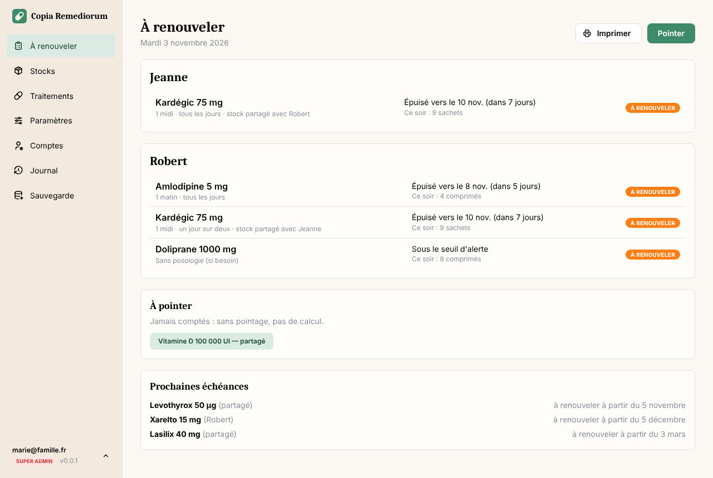
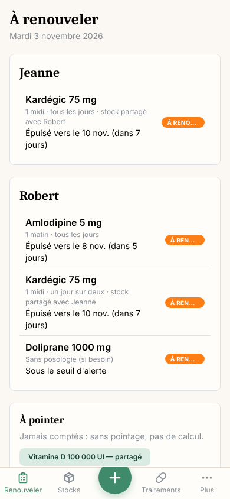
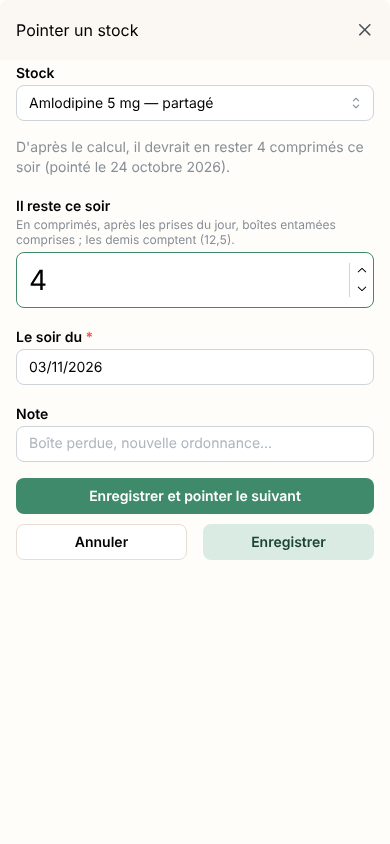
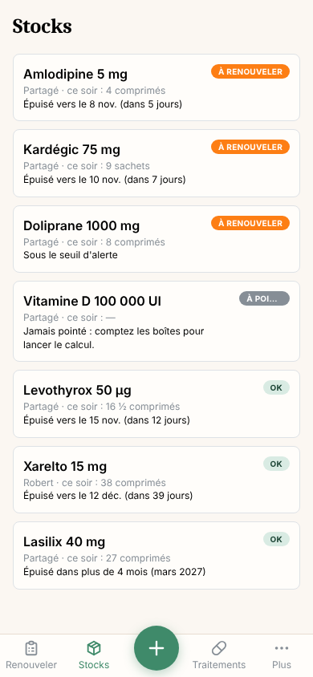
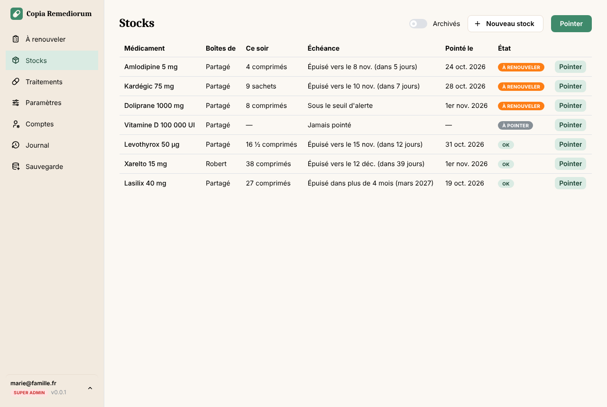
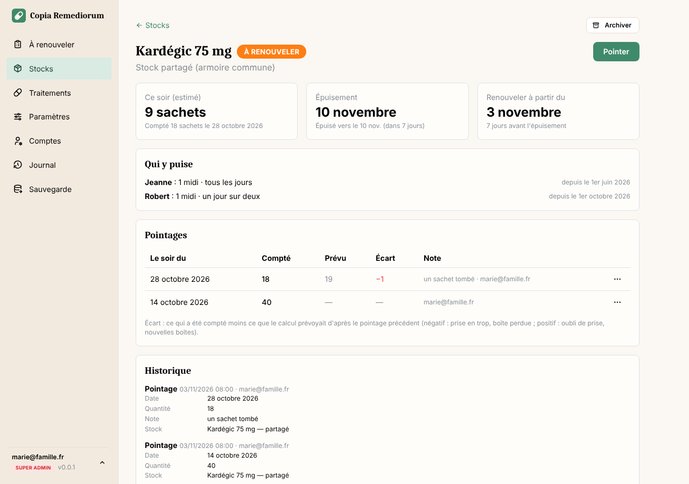
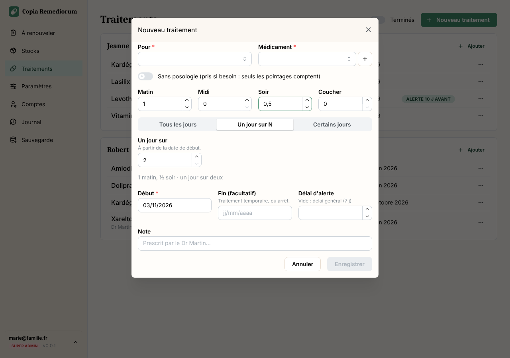

<p align="center">
  
</p>

<h1 align="center">Copia Remediorum</h1>

<p align="center">
  <em>La réserve des remèdes</em> — logiciel libre pour savoir quand faire renouveler les médicaments de ses parents.
</p>

On s'occupe des médicaments de ses parents : l'armoire, les boîtes, les ordonnances. Le but n'est pas de cocher chaque
prise, mais de **ne jamais manquer** : Copia Remediorum connaît la posologie de chacun, compte ce qu'il reste à partir
du dernier comptage, et dit **quand appeler le médecin**, avec une notification sur le téléphone.

<p align="center">
  
</p>

## Ce qu'on y trouve

- **À renouveler** : par personne, les médicaments dans leur délai d'alerte ou épuisés, avec la date d'épuisement
  estimée ; la liste s'imprime pour le rendez-vous.
- **Traitements** : pour chaque personne, ses médicaments et leur posologie — matin, midi, soir, coucher, par quart de
  comprimé ; tous les jours, un jour sur N ou certains jours ; traitement temporaire ; « si besoin ».
- **Stocks** : partagés (l'armoire commune) ou propres à une personne. Le stock estimé ce soir et la date
  d'épuisement se recalculent à chaque **pointage** : on compte ce qui reste, et l'oubli d'une prise ou la boîte perdue
  sont rattrapés.
- **Alertes** : 7 jours avant l'épuisement par défaut, réglable par traitement ; un seuil pour les médicaments pris
  « si besoin ».
- **Notifications** sur le téléphone (application installée) : le jour où l'alerte commence, puis chaque semaine.
- **Comptes** pour la famille ou l'aide à domicile (lecture, écriture, admin), **journal** de chaque modification,
  **sauvegarde** chaque nuit.

<table>
  <tr>
    <td width="33%"></td>
    <td width="33%"></td>
    <td width="33%"></td>
  </tr>
  <tr>
    <td align="center">À renouveler</td>
    <td align="center">Pointer un stock (bouton « + »)</td>
    <td align="center">Stocks</td>
  </tr>
</table>

<p align="center">
  
</p>
<p align="center">
  
</p>
<p align="center">
  
</p>

## Installer (Docker)

```bash
mkdir copia-remediorum && cd copia-remediorum
curl -O https://raw.githubusercontent.com/nayosis/copia-remediorum/main/docker-compose.yml
docker compose up -d
```

Puis ouvrir `http://<serveur>:3000` : le premier compte créé est l'administrateur principal. Réglages facultatifs :
[.env.exemple](.env.exemple). Les notifications demandent une adresse **HTTPS** : derrière un reverse proxy, voir
[docker/nginx-exemple.conf](docker/nginx-exemple.conf). Sur iPhone, ajoutez l'application à l'écran d'accueil (Safari,
Partager, « Sur l'écran d'accueil »), puis activez les notifications depuis le menu du compte.

Les sauvegardes de la nuit restent sur le même disque que les données : recopier le dossier `data/` ailleurs avec les
sauvegardes habituelles du serveur.

## Développement

```bash
bun install
cp .env.exemple .env      # puis choisir le super admin de développement
bun run dev               # interface : http://localhost:5183 (API sur le port 3220)
bun test
bun run type-check
bun run db:generate       # après modification de src/db/schema.ts → nouvelle migration dans drizzle/
```

Bun + Elysia + SQLite (Drizzle) côté serveur, React + Mantine + TanStack côté interface, socle repris du modèle
[Fundamentum](https://github.com/nayosis/fundamentum) (comme [Cura Parentum](https://github.com/nayosis/cura-parentum)).
Conception détaillée : [docs/conception.md](docs/conception.md). Le calcul du stock est dans
[src/lib/stock.ts](src/lib/stock.ts), fonctions pures et testées.

## Licence

[AGPL-3.0-or-later](LICENSE).
